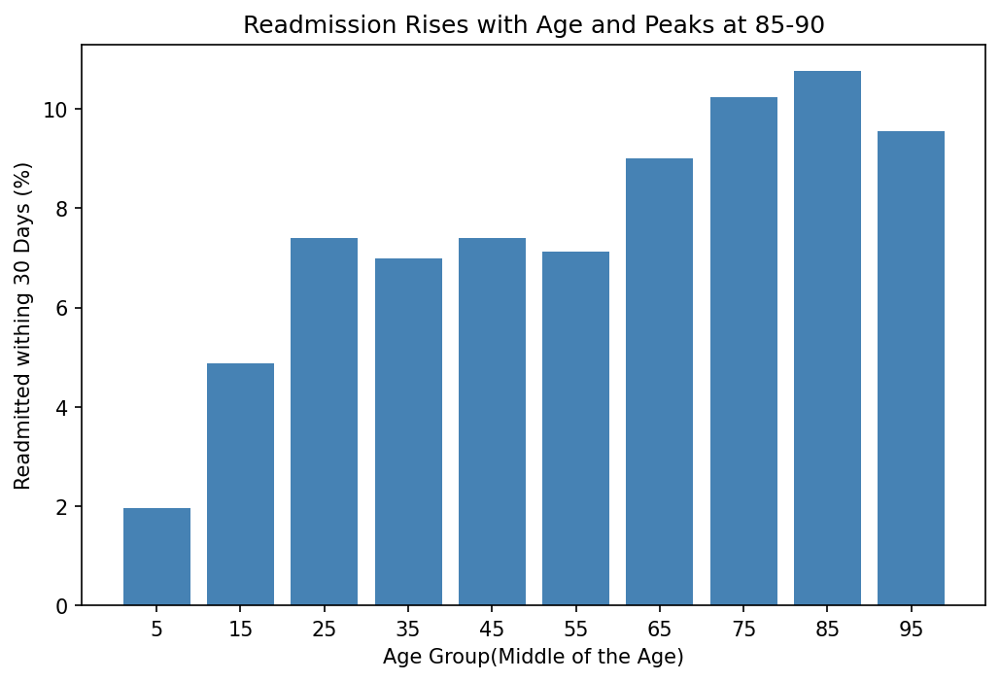
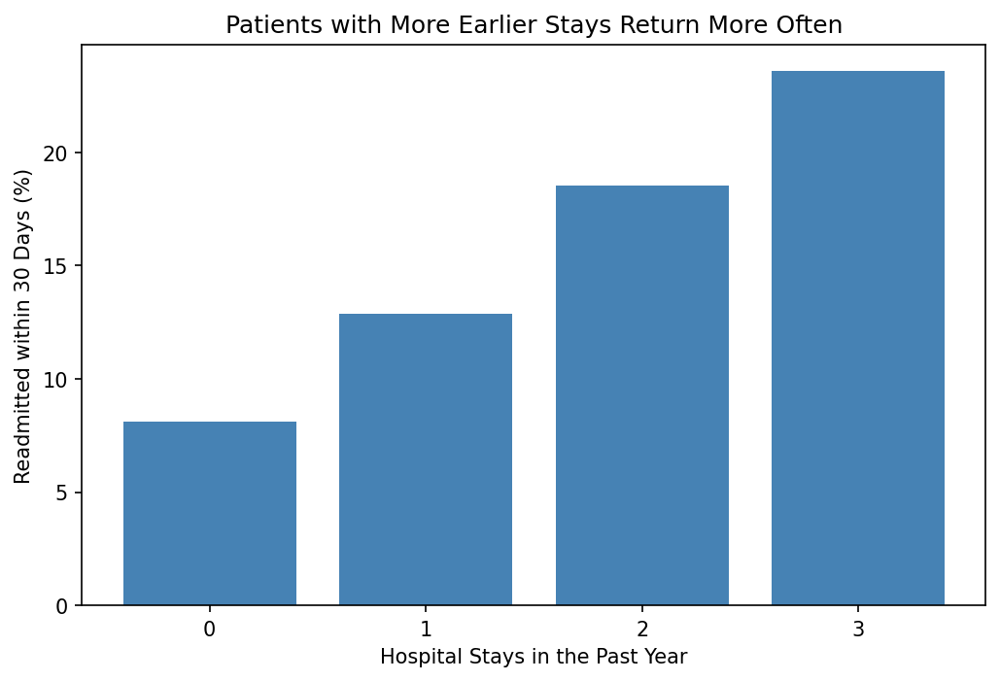
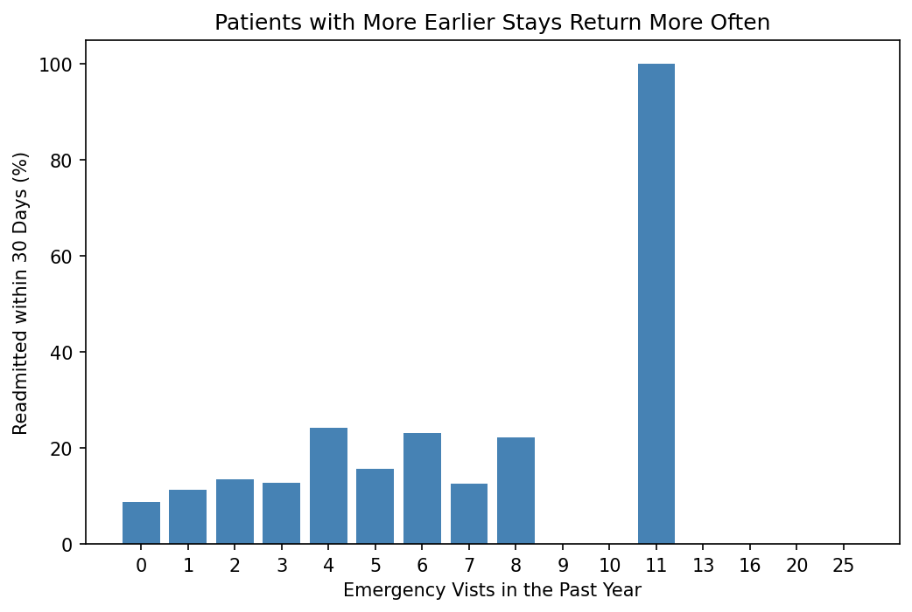
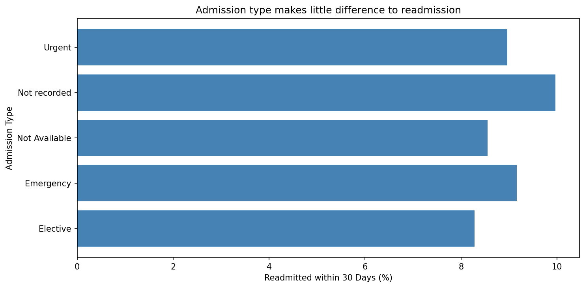
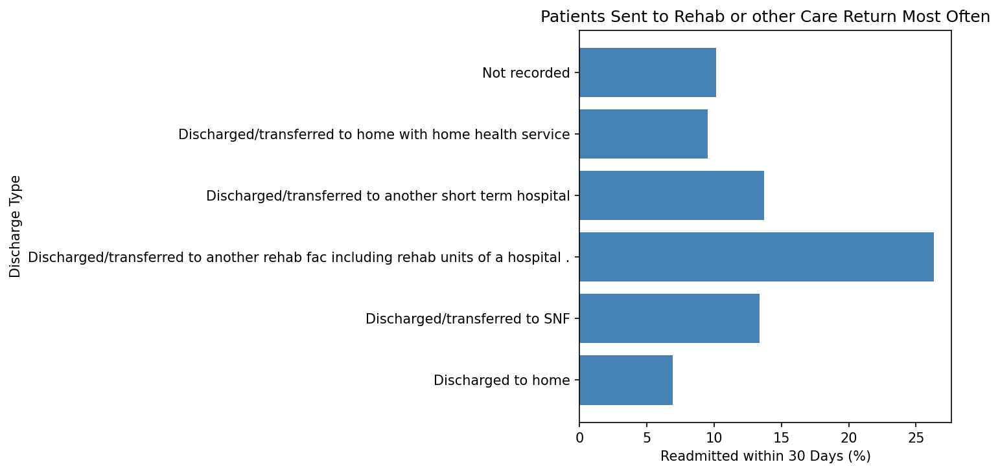
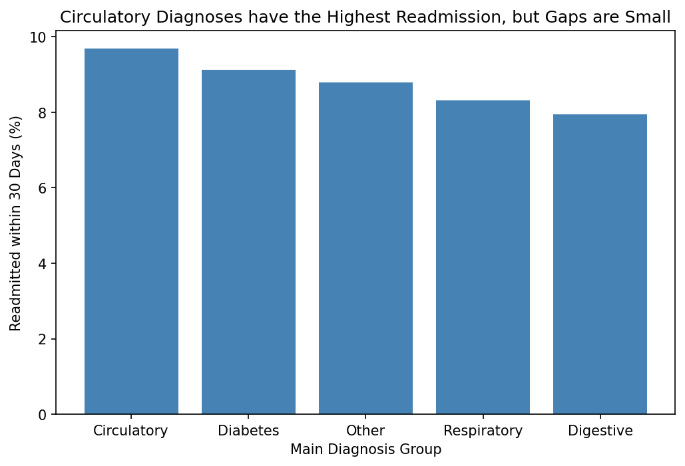

# Diabetic_Readmission_Analysis

# Project Overview
A hospital group is penalised when diabetic patients come back within 30 days. This project analyses hospital records to find which patients are most at risk, so the hospital can follow them up before discharge. The raw data needed a lot of cleaning (missing values written as "?", repeat patients, ID codes with no names, and age stored as ranges) before any analysis.

# Tools Used
- Python
- pandas: For data cleaning and manipulation
- NumPy: For grouping diagnosis codes
- matplotlib: For data visualization

# Data Description
The dataset is the "Diabetes 130-US hospitals for years 1999-2008" data (Kaggle). The ID names come from IDS_mapping.csv on the UCI page.
- Raw data: 101,766 rows and 50 columns (one row per hospital visit)
- Clean data: 69,962 rows and 52 columns (one row per patient)
Key variables:
- patient_nbr: Unique identifier for each patient
- age: Age group of the patient (converted to the middle of each 10-year range)
- time_in_hospital: Number of days in hospital
- number_inpatient: Hospital stays in the previous year
- number_emergency: Emergency visits in the previous year
- discharge_disposition: Where the patient went after discharge
- diag_1: Main diagnosis code (grouped into diag_1_group)
- A1Cresult: Result of the A1C blood sugar test
- readmit_30: Target column, 1 if readmitted within 30 days, 0 if not

# Data Cleaning
Data cleaning steps included:
- Replacing "?" with real missing values
- Dropping weight (about 97% missing) and examide and citoglipton (the same value in every row)
- Filling missing payer_code, medical_specialty, race, diag_2 and diag_3 with "Unknown", and dropping the few rows with no diag_1
- Filling blank A1Cresult and max_glu_serum with "Not tested"
- Removing 3 rows with gender "Unknown/Invalid"
- Keeping only the first visit of each patient, so no patient is counted many times
- Joining IDS_mapping.csv to show admission type, discharge type and admission source as names, not numbers
- Removing patients who died or went to hospice, because they cannot be readmitted
- Creating the target column readmit_30 (1 for readmitted in under 30 days, 0 for "NO" and ">30")
- Converting age ranges into the middle of each range, and grouping diag_1 codes into Circulatory, Diabetes, Respiratory, Digestive and Other
- Checking for duplicate rows and negative numbers, then saving the clean file as diabetic_data_clean.csv

# Business Questions
- What percent of patients were readmitted within 30 days?
- Which age group has the highest readmission?
- Do gender or race matter?
- Does a longer hospital stay mean more readmission?
- Do earlier hospital stays and emergency visits relate to readmission?
- Which admission types and discharge types have the highest readmission?
- Which diagnosis group has the highest readmission?
- Do a medication change or an A1C test relate to readmission?

# Key Insights
- About 9% of patients (8.97%, or 6,275 of 69,962) were readmitted within 30 days.
- Patients with earlier hospital stays returned much more often: the rate rose from 8.1% with no earlier stays to 12.9% with 1, 18.5% with 2 and 23.6% with 3. Earlier emergency visits showed the same pattern.
- Discharge destination mattered most. Patients sent home had the lowest rate (6.95%), while those sent to another rehab facility (26.3%) or other inpatient care (20.6%) had the highest.
- Readmission rose with length of stay (6.5% for 1 day, 12.3% for 8 days) and with age, peaking at 10.8% for ages 80 to 89.
- Gender, race, admission type and diagnosis group made little difference. Their rates stayed within a narrow range of about 7% to 10%.

# Visualization
Charts were created using matplotlib to show:
- Readmission rate by age group
- Readmission rate by earlier hospital stays and emergency visits
- Readmission rate by admission type and discharge type
- Readmission rate by diagnosis group

### Readmission by age group

Readmission rises with age and peaks at 10.8% for patients aged 80 to 89. The very low rate for the youngest group is based on only about 150 patients.

### Readmission by earlier hospital stays

Patients with more hospital stays in the past year return much more often, from 8.1% with no earlier stays to 23.6% with 3.

### Readmission by earlier emergency visits

Earlier emergency visits show the same pattern: 8.7% with none, and about 13% with 2 or 3.

### Readmission by admission type

Admission type makes little difference. The rates stay between about 8% and 10%. Groups with fewer than 1,000 patients are left out.

### Readmission by discharge type

Discharge destination matters most. Patients sent home have the lowest rate (7.0%), while those sent to another rehab facility have the highest (26.3%). Groups with fewer than 1,000 patients are left out.

### Readmission by diagnosis group

Circulatory diagnoses have the highest rate (9.7%) and digestive the lowest (7.9%), but the gap is small.

# Conclusion/recommendation
This analysis shows which patients are most at risk of coming back within 30 days. Before discharge, the hospital should follow up first with patients who have had 2 or more hospital stays in the past year, who are going to rehab or other inpatient care, or who are in their 80s. Gender, race and diagnosis group do not help to pick who is at risk.

# Limitations
- This shows association, not cause. For example, sicker patients may stay longer and also be more likely to return.
- The data is from 1999 to 2008, so today's patterns may be different.
- Some groups are very small (for example, very high numbers of earlier stays), so their rates are not reliable and were left out of the findings.
- Many values were filled with "Unknown" or "Not tested", and age is an estimate (the middle of each range).
- Only each patient's first visit was kept, so later visits are not part of the analysis.

# Author
Franklin Chisom
Data Analyst | Aspiring Data Scientist | SQL, Python, R, and Power BI Enthusiast
